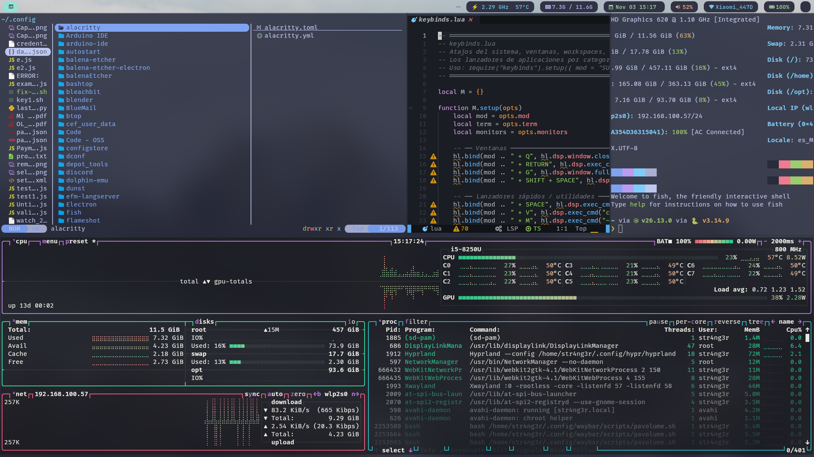

# My Arch Setup — Hyprland

_I made this repo because I don't like wasting time downloading and copying config files._

> Post-installation script for **Arch-based** distros. I recommend Arch or Artix Linux
> because they stay **debloated**.

---

## Philosophy

This dotfile is built around one idea: **make the most of your screen real estate**.

- **Edge-to-edge tiling** — zero gaps, zero borders, zero rounding. Every pixel
  is used by a window, not by decoration. The `dwindle` layout splits space
  automatically so you never drag or resize by hand.
- **Per-monitor workspaces with relative numbering** — `SUPER + <key>` always
  takes you to the *local* workspace of the monitor your cursor is on, so a
  multi-monitor setup feels like several independent, full-screen desktops.
- **Lightweight and optimized** — a Wayland stack (Hyprland + PipeWire + SwayNC)
  with no heavyweight DE running in the background. Idle/lock are handled by
  `hypridle`/`hyprlock`, and the bar/scripts poll only what they need.

The result is a fast, keyboard-driven rice where the content fills the display
and the chrome gets out of the way.



---

## Components

| Role                | Tool                             |
| ------------------- | -------------------------------- |
| Compositor          | hyprland                         |
| Status bar          | waybar                           |
| Notifications       | swaync                           |
| Lock / idle         | hyprlock + hypridle              |
| Launchers           | fuzzel / wofi                    |
| Wallpaper           | swww + waypaper                  |
| Clipboard           | cliphist + wl-clipboard          |
| Screenshots         | grim + slurp                     |
| Audio               | pipewire + pamixer + pavucontrol |
| Media control       | playerctl                        |
| Brightness          | light                            |
| OCR (screen → text) | tesseract (spa + eng)            |
| Terminal / editor   | kitty + AstroNvim                |
| Shell               | fish + starship                  |

---

## Features in detail

### Window management
- **Dwindle tiling** with `preserve_split`, no gaps and no borders for a true
  edge-to-edge workflow.
- **Vim-style navigation**: `SUPER + H/J/K/L` to move focus, add `SHIFT` to move
  the window in that direction.
- Toggle **fullscreen** and **floating** per window.
- Mouse bindings for **drag / resize / center** while holding `SUPER`.

### Multi-monitor
- Workspaces are grouped per monitor (`base = index × 10`), e.g. left monitor gets
  `1–9`, center `11–19`, right `21–29`.
- Bindings are **relative to the monitor under the cursor** — the same keys work
  the same way on every screen.
- **Dynamic rebalancing**: when a monitor is unplugged its windows move to a
  neighbour; when one is plugged in the numbering is reapplied automatically.

### Waybar with rich tooltips
- **Network** (wired/wifi): hover to see IP, signal strength + dBm, frequency,
  gateway, BSSID and live up/down bandwidth.
- **Battery**: capacity, time-to-empty/full, power draw, health and charge cycles.
- **Memory**: RAM used/total/free **plus swap** usage and percentages.
- **Audio**: active output device, port and volume; scroll to change, right-click
  to mute, click to open `pavucontrol`.
- **CPU** module with a click-to-toggle power/performance mode.
- Per-monitor workspaces widget.

### On-screen feedback
- Volume and brightness changes show a **progress-bar notification** via `swaync`
  (replacing the old dunst-only OSD), so every tweak is visible.
- Media keys (play/pause, next, previous, stop) and mic-mute wired through
  `playerctl` / `pactl`.

### Productivity extras
- **OCR**: `SUPER + SHIFT + 0` lets you select a screen region and copies the
  recognized text (Spanish + English) straight to the clipboard.
- **Clipboard history** with `cliphist` (`SUPER + V`).
- **Window switcher** (`SUPER + TAB`) and a screen-mover helper.
- Three screenshot modes: full to clipboard, region to clipboard, region to file.

### Config layout (`~/.config/hypr/`)

The Hyprland configuration is split into readable Lua modules:

| File            | Purpose                                                   |
| --------------- | --------------------------------------------------------- |
| `hyprland.lua`  | Entry point / orchestrator                                |
| `settings.lua`  | Input, general, decoration, animations, dwindle           |
| `monitors.lua`  | Per-monitor workspaces + dynamic rebalancing              |
| `keybinds.lua`  | System / window / workspace / media / screenshot bindings |
| `apps.lua`      | App launchers by category (`SUPER + ALT + key`)           |
| `rules.lua`     | Window rules                                              |
| `autostart.lua` | Processes started with the session                        |

---

## Key bindings (highlights)

| Keys                             | Action                                 |
| -------------------------------- | -------------------------------------- |
| `SUPER + RETURN`                 | Terminal (kitty)                       |
| `SUPER + Q`                      | Close window                           |
| `SUPER + SPACE`                  | App launcher (fuzzel)                  |
| `SUPER + G`                      | Toggle fullscreen                      |
| `SUPER + SHIFT + SPACE`          | Toggle floating                        |
| `SUPER + H/J/K/L`                | Move focus                             |
| `SUPER + SHIFT + H/J/K/L`        | Move window                            |
| `SUPER + A/S/D/F/U/I/O/P`        | Switch to local workspace              |
| `SUPER + SHIFT + <same>`         | Move window to that workspace          |
| `SUPER + ALT + key`              | Launch app (browser, files, editor…)  |
| `SUPER + V`                      | Clipboard history                      |
| `SUPER + TAB`                    | Window switcher                        |
| `Print`                          | Screenshot (full) → clipboard          |
| `SUPER + SHIFT + Print`          | Screenshot (region) → clipboard        |
| `SUPER + Print`                  | Screenshot (region) → file             |
| `SUPER + SHIFT + 0`              | OCR: select region → text to clipboard |
| Volume / brightness / media keys | With on-screen notifications           |

---

## Usage

```bash
git clone https://github.com/STR4NG3R/my-setup-arch
cd my-setup-arch
chmod +x script-install.sh
sudo ./script-install.sh
```

The installer detects CPU microcode, GPU drivers and Bluetooth, installs the base
packages, sets up the Hyprland environment and copies the configs.

## Stack

| Software I use |
| -------------- |
| Hyprland       |
| paru           |
| waybar         |
| swaync         |
| AstroNvim      |
| kitty          |
| fish + starship |
