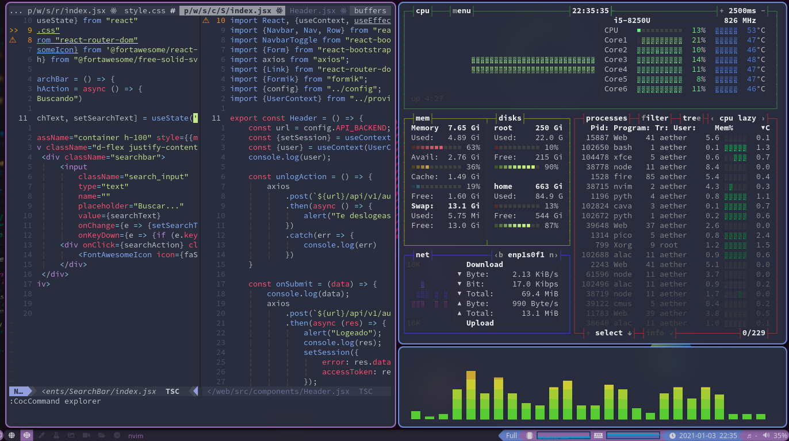
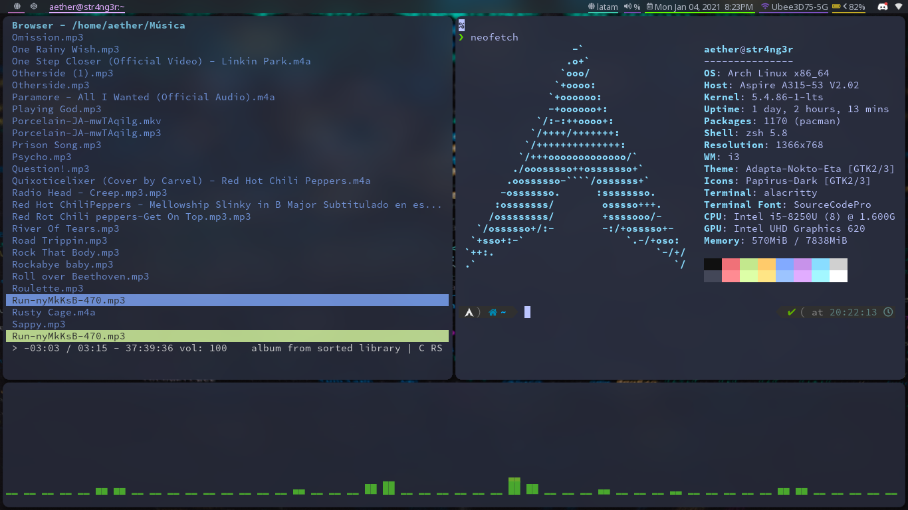

# My Arch Setups

_I made this script because I don't like wasting time downloading and copying config files._

> This script only works on **post-installation** of Arch-based distros.
> I recommend Arch or Artix Linux, because they are **debloated** distros.

---

# Hyprland Setup


A Wayland setup built around **Hyprland** with a Lua-based modular config, **Waybar**,
and **SwayNC** for notifications.

### Components

| Role                | Tool                         |
| ------------------- | ---------------------------- |
| Compositor          | hyprland                     |
| Status bar          | waybar                       |
| Notifications       | swaync                       |
| Lock / idle         | hyprlock + hypridle          |
| Launchers           | fuzzel / wofi                |
| Wallpaper           | swww + waypaper              |
| Clipboard           | cliphist + wl-clipboard      |
| Screenshots         | grim + slurp                 |
| Audio               | pipewire + pamixer + pavucontrol |
| Media control       | playerctl                    |
| Brightness          | light                        |
| OCR (screen → text) | tesseract (spa + eng)        |
| Terminal            | kitty                        |

### Config layout (`~/.config/hypr/`)

The Hyprland configuration is split into Lua modules:

| File            | Purpose                                                   |
| --------------- | --------------------------------------------------------- |
| `hyprland.lua`  | Entry point / orchestrator                                |
| `settings.lua`  | Input, general, decoration, animations                    |
| `monitors.lua`  | Per-monitor workspaces + dynamic rebalancing              |
| `keybinds.lua`  | System / window / workspace / media / screenshot bindings |
| `apps.lua`      | App launchers by category (`SUPER + ALT + key`)           |
| `rules.lua`     | Window rules                                              |
| `autostart.lua` | Processes started with the session                        |

### Key bindings (highlights)

| Keys                  | Action                                 |
| --------------------- | -------------------------------------- |
| `SUPER + RETURN`      | Terminal (kitty)                       |
| `SUPER + Q`           | Close window                            |
| `SUPER + SPACE`       | App launcher (fuzzel)                  |
| `SUPER + H/J/K/L`     | Move focus                             |
| `SUPER + SHIFT + H/J/K/L` | Move window                        |
| `SUPER + A/S/D/F/...` | Switch workspace                       |
| `SUPER + ALT + key`   | Launch app (browser, files, editor...) |
| `SUPER + V`           | Clipboard history                      |
| `SUPER + TAB`         | Window switcher                        |
| `Print`               | Screenshot (full) → clipboard          |
| `SUPER + SHIFT + Print` | Screenshot (region) → clipboard      |
| `SUPER + Print`       | Screenshot (region) → file             |
| `SUPER + SHIFT + 0`   | OCR: select region → text to clipboard |
| Media / volume / brightness keys | Handled with on-screen notifications |

---

# Qtile Setup


# i3 Setup


---

# Usage

```bash
git clone https://github.com/STR4NG3R/my-setup-arch
cd my-setup-arch
chmod +x script-install.sh
sudo ./script-install.sh
```

The installer detects CPU microcode, GPU drivers and Bluetooth, installs the base
packages, then lets you pick a WM setup (Qtile / i3 / Hyprland) and copies the configs.

## Features

_Uniform keybindings across the Qtile, i3 and Hyprland setups._

| Software I use |
| -------------- |
| Hyprland / Qtile / i3 |
| paru           |
| waybar / polybar |
| swaync         |
| AstroNvim      |
| kitty          |
